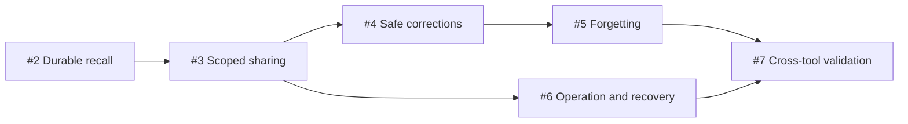

# Tuck v1 implementation plan

The approved specification is [#1](https://github.com/rmkr/tuck/issues/1). The linked GitHub issues contain the acceptance criteria for each delivery step.

## Approved direction

- Build a local Rust MCP application for one user on macOS.
- Keep memory rules behind a database-independent storage interface. Support embedded Turso and optional embedded SurrealDB for new stores. Both adapters must pass the same search, persistence, recovery, and access tests. Track this extension in [#9](https://github.com/rmkr/tuck/issues/9).
- Start with explicit saves and keyword search. Store current content with revision numbers and source metadata.
- Test through the public MCP interface with real storage. Verify the complete lifecycle in two independently authenticated headless agent/client sessions.
- Validate direct MCP connections. Editors are optional. Zed is the default editor when one is used.
- Measure the proposed 100 ms warm-search p95 target over 10,000 memories on this Mac.

## Delivery order

| Step | Ticket | Delivers | Blocked by |
| --- | --- | --- | --- |
| 1 | [#2](https://github.com/rmkr/tuck/issues/2) | A durable save-and-recall path and a measured storage decision. | None |
| 2 | [#3](https://github.com/rmkr/tuck/issues/3) | Scoped credentials and ranked, bounded recall with sources. | [#2](https://github.com/rmkr/tuck/issues/2) |
| 3 | [#4](https://github.com/rmkr/tuck/issues/4) | Revision-checked corrections and safe mutation retries. | [#3](https://github.com/rmkr/tuck/issues/3) |
| 4 | [#5](https://github.com/rmkr/tuck/issues/5) | Deletion that remains effective after retries and restarts. | [#4](https://github.com/rmkr/tuck/issues/4) |
| 5 | [#6](https://github.com/rmkr/tuck/issues/6) | Operator setup, safe startup, recovery, and verified backup/restore. | [#3](https://github.com/rmkr/tuck/issues/3) |
| 6 | [#7](https://github.com/rmkr/tuck/issues/7) | Headless two-client workflow, latency results, and a measured benefit comparison. | [#5](https://github.com/rmkr/tuck/issues/5), [#6](https://github.com/rmkr/tuck/issues/6) |

## Dependencies

The delivery table records the completed implementation order. Safe corrections and operator recovery followed scoped sharing. Final validation covered forgetting and recovery.

## Test approach

Use the approved public MCP test seam with an isolated real database and the running process. Add one failing behavior test, implement that behavior, and repeat. Run the code-review skill before committing each implementation slice.

The v1 tickets and storage-backend follow-ups are complete. The [validation record](validation.md) contains the independent headless agent/client checks, restart tests, latency measurements, and memory-enabled comparisons.
